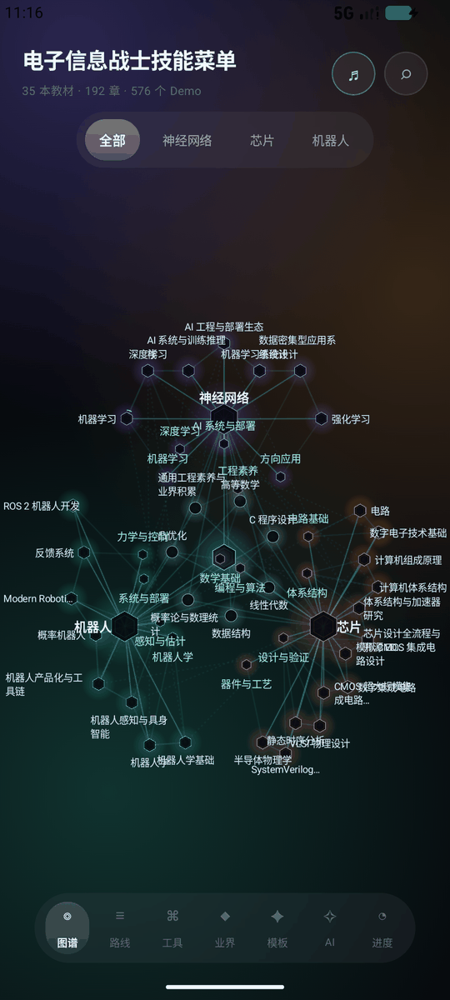
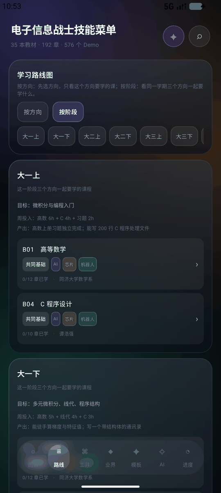
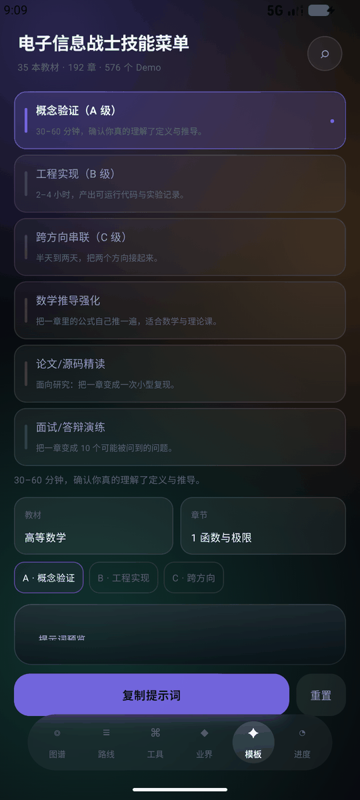
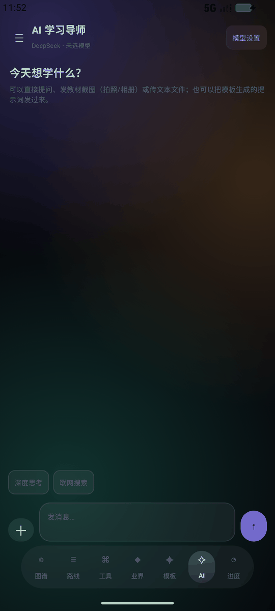
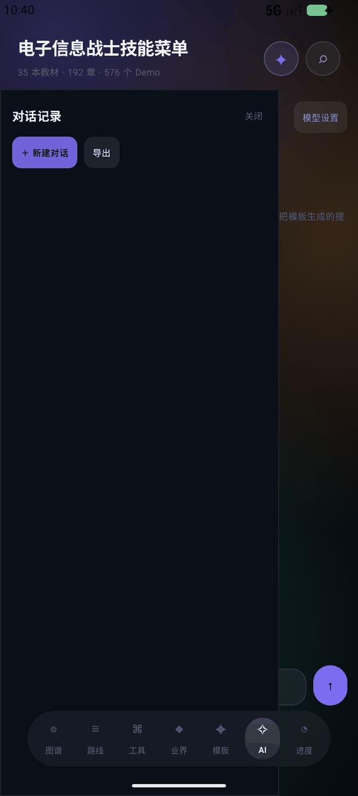
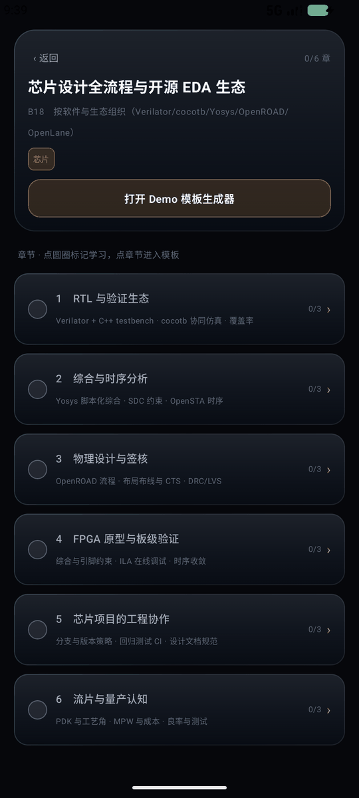

# TriCore · 电子信息战士技能菜单

> **我把电子信息四年的学习路线，做成了赛博朋克 2077 的技能树。**
> 面向电子信息专业学生的学习地图 App：知识图谱 + 精细学习路线 + Demo 提示词工坊 + AI 学习导师。
> **I turned a four-year electronics curriculum into a Cyberpunk 2077 skill tree.**
> An Android study-map app for electronics & CS students: knowledge graph, learning routes, prompt workbench, and an AI tutor.

[](https://developer.android.com)
[](https://kotlinlang.org)
[](https://developer.android.com/jetpack/compose)
[](LICENSE)

**中文** | [English](#english)　·　技术文档：**[中文](docs/TECHNICAL.zh-CN.md)** / **[English](docs/TECHNICAL.en.md)**　·　功能说明：**[中文](docs/FEATURES.zh-CN.md)** / **[English](docs/FEATURES.en.md)**

---

## 目录 / Table of Contents

- [这是什么](#这是什么)
- [截图](#截图)
- [功能](#功能)
- [知识库](#知识库)
- [AI 能力](#ai-能力)
- [界面与动效](#界面与动效)
- [快速开始](#快速开始)
- [项目结构](#项目结构)
- [数据与隐私](#数据与隐私)
- [已知限制](#已知限制)
- [English](#english)

---

## 这是什么

**TriCore** 把一份写给电子信息专业学生的「学习路线手册」变成了可交互的 Android App：

- 不是课程表，而是**图谱**：35 本教材、192 章、576 个练习，按 4 个方向、15 个知识层组织
- 不是书单，而是**路线**：从大一共同底座，到大三三个方向分流，再到硕士 / 博士 / 业界
- 不是 Demo 列表，而是**生成器**：每章 3 个练习（概念验证 / 工程实现 / 跨方向串联）+ 6 套提示词模板，选书选章即生成可复制的提示词
- 不是聊天框，而是**导师**：接入 10 家主流大模型 + 任意第三方 API，能评估进度、答疑、看图讲题

目标用户：电子信息 / 微电子 / 自动化 / 计算机专业的本科生与转行者，以及需要给学生做学习规划的教师。

---

## 截图

| 知识图谱 | 学习路线 | 模板工坊 |
|---|---|---|
|  |  |  |

| AI 导师 | 会话记录 | 教材详情 |
|---|---|---|
|  |  |  |

> 截图来自模拟器；真机效果（120Hz）更顺滑。

---

## 功能

### 知识图谱
- 4 个方向（神经网络 / 芯片 / 机器人 / 基础）→ 15 个知识层 → 35 本教材 → 192 章
- 节点大小表示练习完成度，颜色区分方向，跨层关联用虚线标出
- 标签始终显示、按屏幕坐标缩放；拖拽 / 双指缩放；点方向或知识层可「散开」聚焦
- 点节点进入教材详情：章节列表、逐章标记已学、一键跳模板

### 学习路线
- **按方向**：先选方向，只看该方向的课程；深造（研一 / 研二 / 博士）与业界（Q1–Q4）并入同一方向，配书籍、章节、工具链与业界积累项目
- **按阶段**：同一学期三个方向一起要学什么，每门课带方向标签（多标签 = 共同基础）
- 阶段卡显示目标、周投入、产出验收；所有课程可点进详情、可标记章节

### 提示词工坊
- 6 套固定模板：概念验证（A）/ 工程实现（B）/ 跨方向串联（C）/ 数学推导强化 / 论文源码精读 / 面试答辩演练
- 选教材 → 选章节 → 选等级，实时预览提示词，一键复制或**直接发送到 AI 导师**
- 每章另有 3 条预生成提示词，离线可用

### AI 导师
- 10 家厂商原生接口 + 自定义第三方接入（OpenAI 兼容 / Anthropic / Gemini 三种协议）
- 一键查询模型 ID 并填入；图片（拍照 / 相册）、文本文件附件；深度思考、联网搜索开关（可记忆）
- 会话记录侧栏：新建、切换、删除、导出到剪贴板
- 逐厂商 token 用量统计（输入 / 输出），可清零
- 进度评估：自动汇总已完成章节，生成诊断 + 4 周计划请求

### 进度
- 章节级勾选，书籍 / 方向 / 全局进度环
- **导出**（JSON 到剪贴板）、**导入**（粘贴恢复）、**重置**（二次确认）

### 工具与业界
- 44 个工具链条目，含「怎么学」详细建议、官网链接
- 三大方向的必备经历、作品集要素、招聘信号、时间线，逐条可点开详解

---

## 知识库

`app/src/main/assets/app_data.json`（约 830 KB，完全离线）：

| 维度 | 数量 |
|---|---|
| 方向 | 4（AI / 芯片 / 机器人 / 基础） |
| 知识层 | 15 |
| 教材 | 35（B01–B35） |
| 章节 | 192 |
| 练习 | 576（每章 A/B/C 三级） |
| 工具链条目 | 44 |
| 业界条目 | 每方向 must / portfolio / signals / timeline |

数据来自作者整理的学习手册，**不含受版权保护的教材正文**，只有书名、章节标题与自编练习。

---

## AI 能力

| 厂商 | 协议 | 模型查询 | 图片 |
|---|---|---|---|
| DeepSeek | OpenAI 兼容 | ✅ | ✅ |
| 智谱 GLM | OpenAI 兼容 | ✅ | 取决于模型 |
| Kimi / Moonshot | OpenAI 兼容 | ✅ | 取决于模型 |
| Qwen / 通义 | OpenAI 兼容 | ✅ | 取决于模型 |
| OpenAI | OpenAI 兼容 | ✅ | ✅ |
| Claude / Anthropic | 原生 Messages API | ✅ | ✅ |
| Grok / xAI | OpenAI 兼容 | ✅ | 取决于模型 |
| Gemini | 原生 generateContent | ✅ | ✅ |
| MiniMax | OpenAI 兼容 | ✅ | 取决于模型 |
| MiMo / 小米 | OpenAI 兼容 | ✅ | 取决于模型 |
| 自定义 / 第三方 | OpenAI 兼容 / Anthropic / Gemini | ✅ | 按协议 |

- 联网搜索：OpenAI / xAI 用 `web_search_preview`，Anthropic 用 `web_search_20250305`，Gemini 用 `google_search`，其余走提示词层
- 深度思考：提示词层约束（先推理后结论），不依赖各家私有参数，避免 400
- **API Key 只保存在本机 SharedPreferences，不经过任何中转服务器**，请求直连厂商官方地址

---

## 界面与动效

- **液态玻璃**：内容层与悬浮层分别是两个 `ComposeView`；悬浮层从内容层的 1/8 分辨率快照取景，做实时高斯模糊 + 白色薄涂，因此模糊的是「面板背后的真实内容」，没有自反馈光晕
- 自适应快照频率：渲染耗时 ≤6ms → 60fps，≤12ms → 30fps，否则 15fps
- 方向胶囊用 250ms `FastOutSlowInEasing` 弹性滑动，点击缩放 0.94
- 赛博朋克霓虹配色 + 深色背景 + 程序化生成的 4 分钟环境音（22.05kHz，无版权素材）
- 自定义矢量启动图标

真机（OnePlus / Android 15）实测：拖拽 50th 9–11ms，90th 13–15ms。

---

## 快速开始

### 环境
- Android Studio Ladybug+，JDK 21
- Gradle 8.11.1（wrapper 已包含）
- compileSdk 35，minSdk 26

### 构建

```bash
git clone https://github.com/<your-name>/tricore.git
cd tricore
./gradlew :app:assembleDebug      # 调试包
./gradlew :app:assembleRelease    # 发布包（需自备签名）
```

### 签名（可选）

在 `app/build.gradle.kts` 中配置自己的 keystore，或使用 `~/.gradle/gradle.properties`：

```properties
TRICORE_STORE_FILE=...
TRICORE_STORE_PASSWORD=...
TRICORE_KEY_ALIAS=...
TRICORE_KEY_PASSWORD=...
```

### 安装

```bash
adb install -r app/build/outputs/apk/release/app-release.apk
```

---

## 项目结构

```
app/src/main/
├── java/com/tricore/demolab/
│   ├── MainActivity.kt     # 双 ComposeView、UiState、顶栏/底栏、路由
│   ├── Data.kt             # 数据模型、JSON 解析、ProgressStore
│   ├── Screens.kt          # 路线/工具/业界/进度/搜索等页面与通用组件
│   ├── Graph.kt            # 知识图谱：布局、绘制、手势、标签
│   ├── Glass.kt            # 液态玻璃：快照、模糊、胶囊
│   ├── Roadmap2.kt         # 路线图（按方向/按阶段）与进度页
│   ├── BookDetail.kt       # 教材详情与标签
│   ├── Guide.kt            # 提示词模板工坊
│   ├── Ai.kt               # 厂商协议、模型查询、多模态请求、用量
│   ├── AiChat.kt           # AI 对话页、设置页、会话抽屉
│   └── Sound.kt            # 环境音与点击音
├── assets/app_data.json    # 全部学习数据（离线）
└── res/                    # 图标、主题、FileProvider 配置
```

---

## 数据与隐私

- 学习数据、进度、AI 配置全部**本地存储**（SharedPreferences），无账号、无云同步
- 唯一的网络请求是**你自己触发的 AI 调用**，直连所选厂商；仓库与 App 不含任何密钥
- 教材名称仅作学习索引；练习与提示词为原创
- 若你 fork 后要内置密钥，请使用 `local.properties` 或 CI secret，切勿提交

---

## 已知限制

- 标签在密集区域仍可能重叠（点方向/知识层可散开）
- 图片理解、联网搜索取决于所选模型是否支持
- 附件只读文本类文件（txt / md / 代码 / json / xml / csv），暂不解析 PDF / Word
- 无流式输出；会话仅存在本机
- 仅适配手机竖屏

---

## 贡献

欢迎 issue / PR：新增教材与章节数据、补充工具链条目、修 UI、接更多厂商协议。
提交前请跑 `./gradlew :app:assembleDebug` 并附截图。

## 许可

[MIT](LICENSE) © 2026 TriCore contributors

---

<a id="english"></a>
# English

> An Android study map for electronics & CS students. Combines a knowledge graph, a staged learning roadmap, a prompt-template workbench, and a multi-provider AI tutor.

## What it is

TriCore turns a hand-written study-plan handbook into an interactive app:

- **Graph, not a timetable** — 35 textbooks, 192 chapters, 576 exercises organised into 4 tracks and 15 knowledge layers
- **Routes, not a reading list** — from a shared foundation year, to three specialisations, to master's / PhD / industry
- **Generator, not a demo list** — 3 exercises per chapter (concept / implementation / cross-domain) plus 6 prompt templates; pick a book and chapter and copy a ready prompt
- **Tutor, not a chat box** — 10 providers + any custom endpoint, with progress review, Q&A, and image understanding

## Features

- **Knowledge graph**: 4 tracks → 15 layers → 35 books → 192 chapters; progress-aware node sizes, cross-layer edges, pinch-zoom and drag, tap a track/layer to spread its labels
- **Roadmap**: view by track (AI / chip / robotics, each including master's, PhD and industry stages with books, chapters, toolchain and portfolio items) or by semester (what all three tracks study together)
- **Prompt workbench**: 6 fixed templates (A concept / B implementation / C cross-domain / math derivation / paper reading / interview drill), live preview, copy or send straight to the AI tutor
- **AI tutor**: 10 native providers plus custom endpoints (OpenAI-compatible / Anthropic / Gemini), one-tap model discovery, image & text attachments, deep-thinking and web-search toggles, session history with export, per-provider token accounting
- **Progress**: chapter-level checkmarks, per-book/track/global rings, JSON export/import, reset with confirmation
- **Toolchain & industry library**: 44 tools with "how to learn" notes and official links; per-track must-haves, portfolio items, hiring signals and timelines — every item expands into detail

## AI providers

DeepSeek · Zhipu GLM · Kimi/Moonshot · Qwen · OpenAI · Claude (Anthropic) · Grok (xAI) · Gemini · MiniMax · MiMo · Custom endpoint.

Each provider stores its own key, model and base URL locally. Requests go directly to the provider — there is no relay server and no key in this repository.

## Architecture highlights

- **Two-ComposeView glass**: content and floating chrome are separate `ComposeView`s. The chrome samples a 1/8-resolution snapshot of the content layer, so blur is exact and free of self-feedback halos
- **Adaptive snapshot cadence**: ≤6 ms → 60 fps, ≤12 ms → 30 fps, otherwise 15 fps (50th percentile 9–11 ms while dragging on a 120 Hz device)
- **Fully offline data**: everything lives in `assets/app_data.json` (~830 KB)
- Kotlin 2.0.21, Compose 1.7.5, minSdk 26, compileSdk 35, JDK 21

## Build

```bash
./gradlew :app:assembleDebug
./gradlew :app:assembleRelease   # configure your own signing config first
adb install -r app/build/outputs/apk/release/app-release.apk
```

## Privacy

Progress, settings and API keys stay on the device (SharedPreferences). The only network traffic is the AI request you explicitly trigger, sent directly to the provider you chose.

## Known limitations

Dense label overlap (tap a track/layer to expand), vision/web-search depend on the selected model, text-only attachments, no streaming, phone portrait only.

## License

[MIT](LICENSE) © 2026 TriCore contributors
